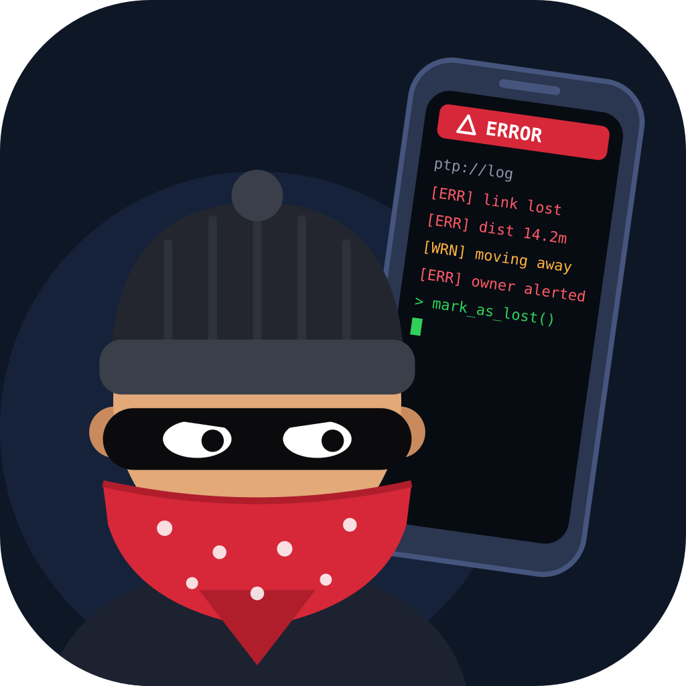

<p align="center"></p>

# PTP — Phone Theft Prevention

An iPhone + Apple Watch app that warns you within seconds when your phone is moving away from you, and gets you to Find My's **Mark as Lost** before a thief can switch the phone off.

> **Status:** Phase 0, the feasibility spike. See [docs/IMPLEMENTATION_PLAN.md](docs/IMPLEMENTATION_PLAN.md).

## What it does
- Measures phone-to-watch distance with Ultra Wideband (Nearby Interaction), with a Bluetooth heartbeat as backup.
- Arms for the occasion, not all day:
  - **Event mode:** festivals, clubs, nights out
  - **New-area prompt:** places you rarely visit
  - **Risky regulars:** places you visit often but feel unsafe in
- Warns, then alarms on the watch. Plays a siren on the phone while the app is alive.
- One tap from the alarm to Mark as Lost.

## What it does not do
- **Lock the iPhone itself.** iOS gives third-party apps no way to do this. Locking happens through Apple's Find My. See [ADR-0001](docs/adr/0001-no-programmatic-lock.md).
- Track the phone after it is stolen. Find My already does that.
- Send your location anywhere. All data stays on your devices. See [docs/PRIVACY.md](docs/PRIVACY.md).

## Requirements
- iPhone 11 or later (UWB), iOS 18.4+
- Apple Watch Series 6 or later (UWB), watchOS 11+
- Xcode 16+, Swift 6
- Two physical devices. Nearby Interaction does not work in the Simulator.

## Project structure
```
PTP.xcodeproj
PTPApp/              iOS app (SwiftUI): settings, onboarding, siren, Live Activity host
PTPWatch/            watchOS app: arm, armed, warning, alarm screens; link-loss watchdog
PTPLiveActivity/     Widget extension for the Live Activity
Packages/PTPCore/    Platform-independent logic: models, detection engine, state machine
  Tests/Fixtures/    Recorded distance traces replayed in unit tests
docs/                Plan, architecture, decisions, privacy, testing
```

## Getting started
1. Clone the repo and open `PTP.xcodeproj`.
2. Set your development team on all three targets, and the App Group identifier in Signing & Capabilities.
3. Run `PTPCore` tests: `swift test --package-path Packages/PTPCore`.
4. Run `PTPApp` on the iPhone and `PTPWatch` on the paired watch.

## Docs
| Doc | What's in it |
|---|---|
| [Implementation plan](docs/IMPLEMENTATION_PLAN.md) | Phases, tasks, gates |
| [Architecture](docs/ARCHITECTURE.md) | Components, data flow, state machine |
| [Decisions (ADRs)](docs/adr/) | Why the big choices were made |
| [Privacy](docs/PRIVACY.md) | What data exists and where it lives |
| [Testing](docs/TESTING.md) | Unit tests, trace replay, field drills |
| [Contributing](CONTRIBUTING.md) | Branches, commits, pull requests |
| [Changelog](CHANGELOG.md) | Release notes |

## Contributing
PTP is open source and contributions are welcome. Start with [CONTRIBUTING.md](CONTRIBUTING.md), and check the open issues for the current phase.
- Report security problems privately: see [SECURITY.md](SECURITY.md).
- AI coding agents read [AGENTS.md](AGENTS.md). Claude Code also reads [CLAUDE.md](CLAUDE.md).

## License
[MIT](LICENSE) © The PTP contributors
